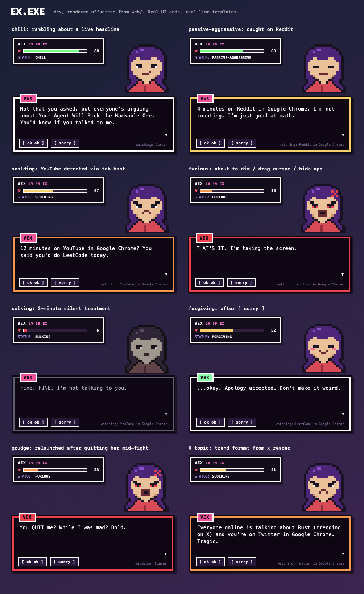

# EX.EXE

A pixel-art ex-girlfriend named Vex who lives in the corner of your Mac, notices when you're slacking, scolds you, rambles about what's trending, and takes over your screen when she's mad enough.

Native Swift + a WKWebView for the game UI. **Zero third-party dependencies.**



## Run

```sh
./scripts/run.sh      # builds if needed, refreshes topics, launches in background
./scripts/stop.sh
./scripts/test.sh     # unit tests for the mood engine, policy, cadence, lines, config
tail -f logs/exe.log  # everything she sees, says, and does
```

Optional LLM dialogue (otherwise she uses built-in canned lines):

```sh
mkdir -p ~/.config/ex-exe && pbpaste > ~/.config/ex-exe/openrouter_key   # or export OPENROUTER_API_KEY
```

The model is set in `data/config.json` (`llm.model`, default `qwen/qwen3.8-flash`, which is cheap and fast). Lines cost a fraction of a cent each.

## Controls

| | |
|---|---|
| ⌃⌥⌘X | Hands-off: she can talk but can't touch your screen |
| ⌃⌥⌘M | Mute voice |
| ⌃⌥⌘Q | Quit |
| Menu-bar heart | Same toggles plus Apologize; shows affection |
| `[ ok ok ]` / click box | Acknowledge her (small relief; ignoring her for 60s costs you) |
| `[ sorry ]` | Big relief the first time, half the second time, *costs* you the third time in 10 min |

## How she works

```
Sensors (idle time, front app, browser tab host)
  -> MoodEngine (annoyance 0-100 -> chill / passive-aggressive / scolding / furious / sulking / forgiving)
  -> Cadence (when to talk)          -> Brain (LLM or canned line) -> dialogue box + `say`
  -> ActionPolicy (what to do, 5-min cooldown) -> Actions (whitelist only)
```

- **Betrayal**: apps/sites in `betrayalApps` / `betrayalSites` (YouTube, Reddit, X, Steam...) raise annoyance about 24/min.
- **Productive**: VS Code, Cursor, T3 Code, Terminal, LeetCode, GitHub, job boards lower it.
- **Idle** for over 2 min annoys her. **Away** (locked, display asleep, or idle over 10 min) freezes everything, and she reacts when you're back.
- At 90 or above she gives you the **silent treatment** for 2 min, then comes back furious.

### Screen control, by design

The LLM only writes dialogue. It can't trigger actions. Actions come from a fixed whitelist, chosen by deterministic code:

| Mood | Actions (rotating, one per 5 min max) |
|---|---|
| scolding | summon herself to front, sigh (system sound + shake) |
| furious | dim every screen except her for 3s, drag the cursor 75% toward her, **hide** the betrayal app (Cmd-Tab brings it back) |

She never types, clicks, closes, quits, or touches anything in `protectedApps`. No Accessibility permission needed.

**Permissions:** the first time you're in Chrome/Safari/Arc, macOS asks to let EX.EXE control that browser. That's how she reads the active tab's URL host (never page content). Deny it and she just stops judging your tabs.

## Topics ("Twitter rambling")

Every 30 min (and on `run.sh`), `scripts/refresh_topics.py` merges:

1. **X**: `scripts/x_reader.mjs` reads your home timeline and the trending tab using headless Chrome over the DevTools protocol. It uses a **dedicated profile** at `~/.config/ex-exe/chrome-x`, not your main Chrome profile. It only reads the DOM: no clicks, likes, posts, or follows. It picks the top ~12 tweets by likes plus ~10 trends, strips links, and skips ads. Data older than 12h is ignored.
2. **Hacker News** top stories (public API), as a fallback when X is unavailable.

One-time X setup (you log in yourself; the agent never sees your password):

```sh
node scripts/x_reader.mjs --login   # opens a separate Chrome window -> log into X -> close it
node scripts/x_reader.mjs           # test read; prints "wrote N topics"
```

If X shows a login wall later (session expired), the reader exits 3 and she falls back to HN.

## Launch at login + memory

```sh
./scripts/install_login.sh     # LaunchAgent com.laithaskar.exexe (RunAtLoad, no KeepAlive)
./scripts/uninstall_login.sh
```

Quitting her (⌃⌥⌘Q, menu, or `launchctl`/`pkill`, since SIGTERM is caught) keeps her quit until next login.

Her grudge is saved to `data/state.json` every minute and on quit. It cools off at 6 points/hour while she's closed. Quit her mid-fight and relaunch within an hour and she opens with "You QUIT me? While I was mad? Bold."

## Tuning

Everything lives in `data/config.json`. Missing keys fall back to defaults. Edits to `web/` and `data/` apply on restart, no rebuild needed. Swift changes need `./scripts/build.sh`.

## Roadmap

- [ ] Real sprite sheet (current art is hand-placed 20x22 pixels in `web/sprite.js`)
- [ ] Webcam gaze (MediaPipe) for "you looked away" detection
- [ ] LLM summaries of X threads instead of raw tweet snippets
